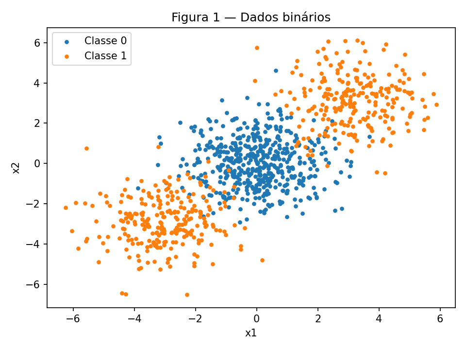
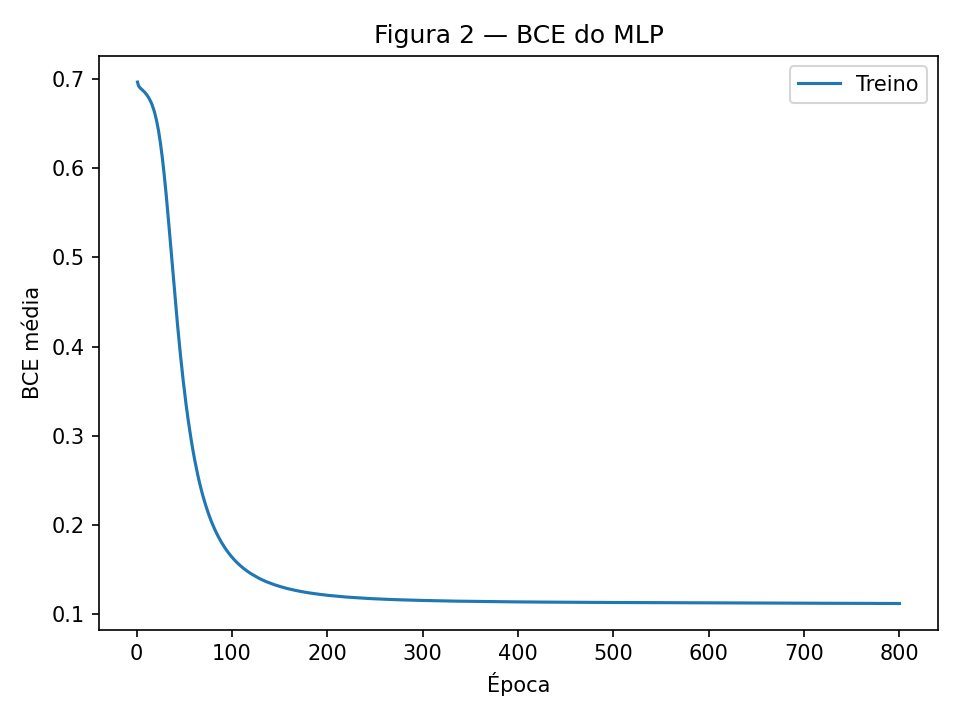
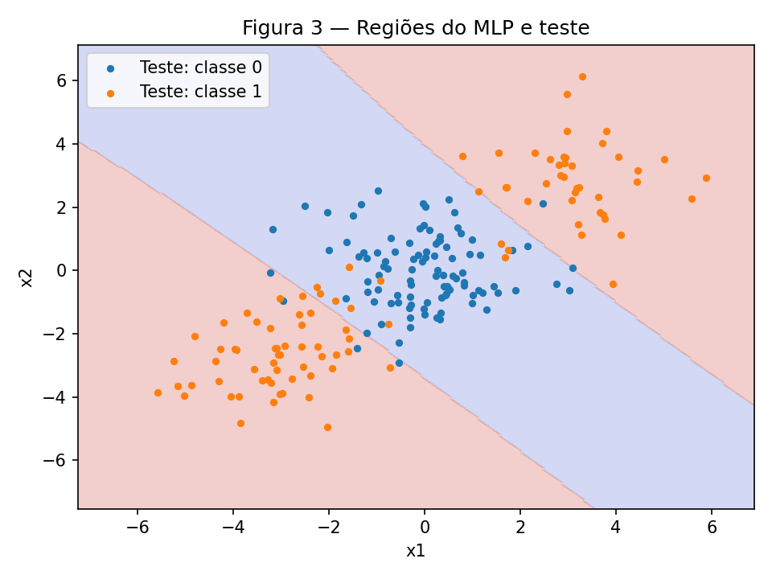
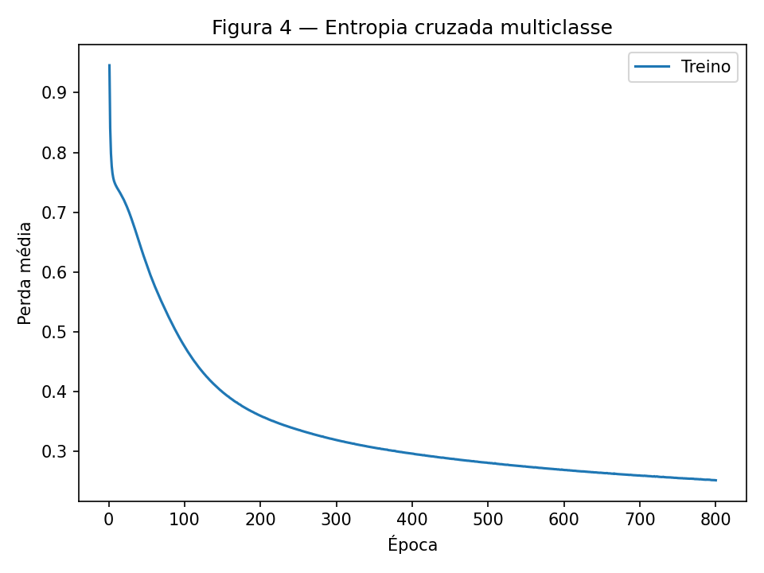
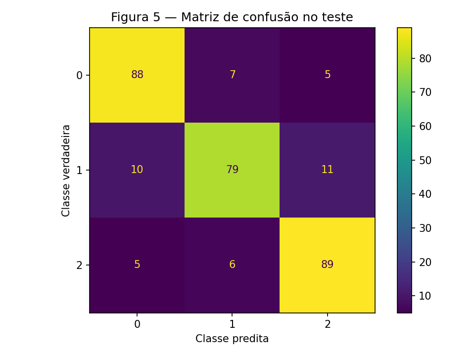
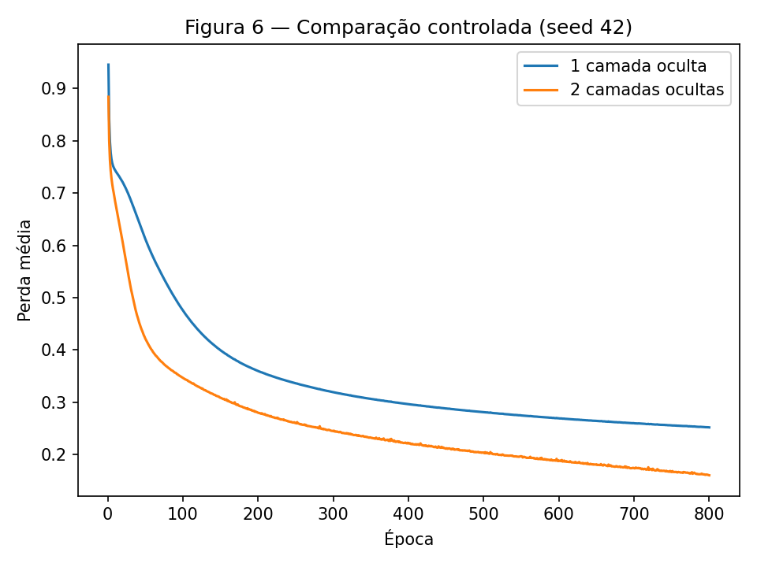

# MLP — Backpropagation passo a passo

**Autor:** João Bresser Pereira  
**Disciplina:** Artificial Neural Networks and Deep Learning — 2026.2

[Enunciado da atividade](https://insper.github.io/ann-dl/2026.2/exercises/mlp/) · [Código-fonte deste relatório](https://github.com/Joao-kouznetz/ann-dl/blob/main/docs/exercises/mlp/index.md)

Esta entrega resolve os Exercises 1 a 4. O Exercise 1 preserva a derivação analítica; os demais usam o mesmo MLP implementado em NumPy. O desenvolvimento do Exercise 1 é analítico, com as substituições numéricas explícitas; os valores são exibidos com seis casas decimais, mantendo a precisão completa nos cálculos intermediários.

## Exercise 1

Uma etapa de backpropagation em uma rede com duas entradas, dois neurônios ocultos e uma saída. As duas camadas usam a ativação $\tanh$ e a perda, para uma única amostra, é:

$$
L=(y-\hat y)^2.
$$

Os dados e os parâmetros iniciais são:

$$
\mathbf x=\begin{bmatrix}0.5\\-0.2\end{bmatrix},\qquad y=1.0,\qquad \eta=0.3,
$$

$$
\mathbf W^{(1)}=\begin{bmatrix}0.3&-0.1\\0.2&0.4\end{bmatrix},\qquad
\mathbf b^{(1)}=\begin{bmatrix}0.1\\-0.2\end{bmatrix},
$$

$$
\mathbf W^{(2)}=\begin{bmatrix}0.5&-0.3\end{bmatrix},\qquad b^{(2)}=0.2.
$$

Cada linha de $\mathbf W^{(1)}$ corresponde a um neurônio oculto. Embora o enunciado mencione oito parâmetros, os valores fornecidos definem **nove parâmetros escalares**: quatro pesos ocultos, dois vieses ocultos, dois pesos de saída e um viés de saída. Todos são atualizados no item C.

### A — Forward pass

**1. Pré-ativações da camada oculta**

$$
\mathbf z^{(1)}=\mathbf W^{(1)}\mathbf x+\mathbf b^{(1)}.
$$

Para cada neurônio:

$$
z^{(1)}_1=0.3(0.5)+(-0.1)(-0.2)+0.1
=0.15+0.02+0.1=\boxed{0.270000},
$$

$$
z^{(1)}_2=0.2(0.5)+0.4(-0.2)-0.2
=0.10-0.08-0.2=\boxed{-0.180000}.
$$

**2. Ativações da camada oculta**

Aplicando $\tanh(z)=(e^{2z}-1)/(e^{2z}+1)$ a cada componente:

$$
h^{(1)}_1=\tanh(0.27)=\boxed{0.263625},\qquad
h^{(1)}_2=\tanh(-0.18)=\boxed{-0.178081}.
$$

**3. Pré-ativação da saída**

$$
\begin{aligned}
u^{(2)}&=\mathbf W^{(2)}\mathbf h^{(1)}+b^{(2)}\\
&=0.5(0.2636248355)+(-0.3)(-0.1780808681)+0.2\\
&=0.1318124177+0.0534242604+0.2\\
&=\boxed{0.385237}.
\end{aligned}
$$

**4. Predição e perda**

$$
\hat y=\tanh(0.3852366782)=\boxed{0.367247},
$$

$$
L=(1-0.3672465626)^2=\boxed{0.400377}.
$$

A saída está abaixo do alvo $y=1$; a atualização deve aproximar a predição desse alvo para reduzir a perda.

### B — Backward pass

Usamos a regra da cadeia, começando pela perda e propagando os gradientes até os parâmetros da primeira camada. A derivada da ativação é:

$$
\frac{d\tanh(v)}{dv}=1-\tanh^2(v).
$$

**1. Gradiente em relação à predição e à pré-ativação da saída**

$$
\frac{\partial L}{\partial\hat y}
=\frac{\partial(y-\hat y)^2}{\partial\hat y}
=2(\hat y-y)
=2(0.3672465626-1)
=\boxed{-1.265507}.
$$

$$
\frac{\partial\hat y}{\partial u^{(2)}}
=1-\hat y^2=1-(0.3672465626)^2
=\boxed{0.865130}.
$$

Definindo $\delta^{(2)}=\partial L/\partial u^{(2)}$:

$$
\delta^{(2)}
=\frac{\partial L}{\partial\hat y}\frac{\partial\hat y}{\partial u^{(2)}}
=(-1.2655068747)(0.8651299622)
=\boxed{-1.094828}.
$$

**2. Gradientes dos pesos e do viés de saída**

Como $u^{(2)}=W^{(2)}_1h^{(1)}_1+W^{(2)}_2h^{(1)}_2+b^{(2)}$, temos $\partial u^{(2)}/\partial W^{(2)}_j=h^{(1)}_j$ e $\partial u^{(2)}/\partial b^{(2)}=1$. Portanto:

$$
\frac{\partial L}{\partial W^{(2)}_1}
=\delta^{(2)}h^{(1)}_1
=(-1.0948279147)(0.2636248355)
=\boxed{-0.288624},
$$

$$
\frac{\partial L}{\partial W^{(2)}_2}
=\delta^{(2)}h^{(1)}_2
=(-1.0948279147)(-0.1780808681)
=\boxed{0.194968},
$$

$$
\frac{\partial L}{\partial b^{(2)}}
=\delta^{(2)}=\boxed{-1.094828}.
$$

**3. Propagação até as ativações e pré-ativações ocultas**

Primeiro, $\partial u^{(2)}/\partial h^{(1)}_j=W^{(2)}_j$:

$$
\frac{\partial L}{\partial h^{(1)}_1}
=\delta^{(2)}W^{(2)}_1
=(-1.0948279147)(0.5)
=\boxed{-0.547414},
$$

$$
\frac{\partial L}{\partial h^{(1)}_2}
=\delta^{(2)}W^{(2)}_2
=(-1.0948279147)(-0.3)
=\boxed{0.328448}.
$$

As derivadas locais das ativações ocultas são:

$$
1-(h^{(1)}_1)^2=\boxed{0.930502},\qquad
1-(h^{(1)}_2)^2=\boxed{0.968287}.
$$

Assim, definindo $\delta^{(1)}_j=\partial L/\partial z^{(1)}_j$:

$$
\delta^{(1)}_1
=\frac{\partial L}{\partial h^{(1)}_1}\bigl(1-(h^{(1)}_1)^2\bigr)
=(-0.5474139574)(0.9305019461)
=\boxed{-0.509370},
$$

$$
\delta^{(1)}_2
=\frac{\partial L}{\partial h^{(1)}_2}\bigl(1-(h^{(1)}_2)^2\bigr)
=(0.3284483744)(0.9682872044)
=\boxed{0.318032}.
$$

Os pesos utilizados nessa propagação são os **pesos originais** da saída. Nenhum parâmetro é alterado antes de todos os gradientes serem calculados.

**4. Gradientes dos pesos e dos vieses ocultos**

De $z^{(1)}_j=\sum_iW^{(1)}_{ji}x_i+b^{(1)}_j$, obtemos:

$$
\frac{\partial L}{\partial W^{(1)}_{ji}}=\delta^{(1)}_jx_i,\qquad
\frac{\partial L}{\partial b^{(1)}_j}=\delta^{(1)}_j.
$$

Aplicando a expressão a cada peso:

$$
\begin{aligned}
\frac{\partial L}{\partial W^{(1)}_{11}}&=(-0.5093697527)(0.5)=\boxed{-0.254685},\\
\frac{\partial L}{\partial W^{(1)}_{12}}&=(-0.5093697527)(-0.2)=\boxed{0.101874},\\
\frac{\partial L}{\partial W^{(1)}_{21}}&=(0.3180323583)(0.5)=\boxed{0.159016},\\
\frac{\partial L}{\partial W^{(1)}_{22}}&=(0.3180323583)(-0.2)=\boxed{-0.063606}.
\end{aligned}
$$

Para os vieses:

$$
\frac{\partial L}{\partial b^{(1)}_1}=\boxed{-0.509370},\qquad
\frac{\partial L}{\partial b^{(1)}_2}=\boxed{0.318032}.
$$

Em forma matricial, os gradientes da primeira camada são:

$$
\frac{\partial L}{\partial\mathbf W^{(1)}}=
\begin{bmatrix}-0.254685&0.101874\\0.159016&-0.063606\end{bmatrix},\qquad
\frac{\partial L}{\partial\mathbf b^{(1)}}=
\begin{bmatrix}-0.509370\\0.318032\end{bmatrix}.
$$

### C — Parameter update

A descida do gradiente atualiza cada parâmetro pela regra:

$$
\theta_{\mathrm{novo}}=\theta_{\mathrm{original}}-0.3\frac{\partial L}{\partial\theta}.
$$

Todas as atualizações usam os gradientes do mesmo forward pass. A tabela mostra a substituição e o resultado para cada um dos nove parâmetros; os resultados usam os gradientes sem arredondamento.

| Parâmetro | Valor original | Gradiente | Atualização com $\eta=0.3$ | Novo valor |
| --- | ---: | ---: | --- | ---: |
| $W^{(1)}_{11}$ | 0.300000 | −0.254685 | $0.3-0.3(-0.2546848763)$ | **0.376405** |
| $W^{(1)}_{12}$ | −0.100000 | 0.101874 | $-0.1-0.3(0.1018739505)$ | **−0.130562** |
| $W^{(1)}_{21}$ | 0.200000 | 0.159016 | $0.2-0.3(0.1590161791)$ | **0.152295** |
| $W^{(1)}_{22}$ | 0.400000 | −0.063606 | $0.4-0.3(-0.0636064717)$ | **0.419082** |
| $b^{(1)}_1$ | 0.100000 | −0.509370 | $0.1-0.3(-0.5093697527)$ | **0.252811** |
| $b^{(1)}_2$ | −0.200000 | 0.318032 | $-0.2-0.3(0.3180323583)$ | **−0.295410** |
| $W^{(2)}_1$ | 0.500000 | −0.288624 | $0.5-0.3(-0.2886238289)$ | **0.586587** |
| $W^{(2)}_2$ | −0.300000 | 0.194968 | $-0.3-0.3(0.1949679055)$ | **−0.358490** |
| $b^{(2)}$ | 0.200000 | −1.094828 | $0.2-0.3(-1.0948279147)$ | **0.528448** |

**A perda aumenta ou diminui?**

Ela **diminui** neste caso. Para confirmar com os parâmetros atualizados, repetimos o forward pass:

$$
\begin{aligned}
z^{(1)}_{1,\mathrm{novo}}
&=0.3764054629(0.5)+(-0.1305621852)(-0.2)+0.2528109258\\
&=\boxed{0.467126},\\
z^{(1)}_{2,\mathrm{novo}}
&=0.1522951463(0.5)+0.4190819415(-0.2)-0.2954097075\\
&=\boxed{-0.303079}.
\end{aligned}
$$

$$
\mathbf h^{(1)}_{\mathrm{novo}}=
\begin{bmatrix}\tanh(0.4671260943)\\\tanh(-0.3030785226)\end{bmatrix}
=\begin{bmatrix}0.435874\\-0.294127\end{bmatrix}.
$$

$$
\begin{aligned}
u^{(2)}_{\mathrm{novo}}
&=0.5865871487(0.4358743310)+(-0.3584903716)(-0.2941273491)+0.5284483744\\
&=\boxed{0.889568},\\
\hat y_{\mathrm{novo}}&=\tanh(0.8895684781)=\boxed{0.711181},\\
L_{\mathrm{novo}}&=(1-0.7111805295)^2=\boxed{0.083417}.
\end{aligned}
$$

A predição passa de **0.367247** para **0.711181**, aproximando-se do alvo **1.000000**, e a perda cai de **0.400377** para **0.083417**. O gradiente indica a direção local de maior aumento da perda; subtraí-lo produz uma direção de descida. Uma taxa de aprendizado arbitrariamente grande não garante redução, mas a segunda avaliação confirma que $\eta=0.3$ reduz a perda para esta amostra.

## Código reproduzível

[Notebook executável](code/MLP.ipynb) · [MLP em NumPy](code/mlp.py) · [Experimentos](code/run_analysis.py) · [Resultados completos](code/results.json).

```bash
python docs/exercises/mlp/code/run_analysis.py
python docs/exercises/mlp/code/write_report.py
```

Nenhum framework de redes é usado no MLP. NumPy implementa ativações, perdas, gradientes e SGD;
scikit-learn gera/divide os dados e calcula as matrizes. LogisticRegression é usada apenas nos baselines,
como autorizado. A padronização usa média e desvio do treino (NumPy); os índices e geradores de dados
seguem o enunciado. Não foram escolhidos hiperparâmetros por acurácia no teste.

## Exercise 2

### A — Generate the data

Geramos 1.000 pontos com centros (0,0), (3,3), (-3,-3), desvios 1,2 e tamanhos 500/250/250.
Os dois centros externos formam a classe 1; o central, a classe 0. O gerador e o split estratificado
80/20 usam random_state=42, deixando 800 exemplos de treino e 200 de teste, com 100 por classe no teste.



Os grupos externos cercam o centro em direções opostas; uma reta não isola as duas extremidades do centro.

### B — Establish the baseline

LogisticRegression foi ajustada só no treino padronizado: **47.50% de acurácia no teste**.
Isso descreve esta amostra finita; abaixo de 50% não significa que todo classificador linear seja pior
que um sorteio em toda população. A simetria aproxima a média das duas classes e a reta não capta
que classe 1 ocupa duas regiões opostas.

### C — Implement the MLP

Arquitetura **2 → 32 (tanh) → 1 (sigmoid)**, 129 parâmetros, SGD com taxa **0,05**,
mini-batches **64**, **800 épocas**. A BCE estável é logaddexp(0,u)−y·u, evitando log(0).
A acurácia de teste foi **92.00%** e a BCE final de treino, **0.111720**.
A inicialização Xavier normal e o embaralhamento usam geradores NumPy com seed 42.

Para uma camada H=tanh(AW+b), temos dL/dW=Aᵀδ, dL/db=Σδ e
δ anterior=(δWᵀ)⊙(1−A²). Na saída sigmoid+BCE, dL/du=(p−y)/B.
A divisão por B ocorre uma vez, na saída; cada gradiente propaga a perda média.
Todos os gradientes são calculados antes da atualização θ←θ−η∇L.
Diferenças finitas centrais verificaram cada peso e viés em redes binária e multiclasse com
profundidades diferentes: maior erro absoluto **1.374e-11**.



A curva registra a perda no treino completo após cada época, sem misturar perdas de pesos diferentes.



### D — Analysis

O MLP alcançou 92.00%, contra 47.50% do baseline, porque combina
unidades ocultas em regiões não lineares. A Figura 3 atribui as duas extremidades à classe 1 e o
miolo à classe 0; uma única reta só divide o plano em dois semiplanos. Há sobreposição das Gaussianas,
então não se espera classificação perfeita. A fronteira não é inferida da acurácia: está desenhada
com predições da rede em uma grade, sobre os pontos de teste que não participaram do ajuste.

## Exercise 3

### A — Generate the data

make_classification usa 1.500 exemplos, quatro atributos informativos, nenhum redundante/repetido,
três classes, dois clusters por classe, class_sep=1 e random_state=42. Split estratificado 80/20:
1.200 exemplos de treino e 300 de teste. A padronização é ajustada no treino.

### B — Adapt the network

Reutilizamos sem alteração a classe MLP, inclusive forward, backward e atualização. Apenas o
argumento da camada de saída muda para três unidades. Para logits u, pₖ=exp(uₖ)/Σexp(uⱼ), calculados
subtraindo max(u) para estabilidade. Com alvo one-hot y e Σyₖ=1:

$$L=-\sum_k y_k\log p_k=-\sum_k y_k u_k+\log\sum_j e^{u_j}.$$

Logo ∂L/∂uᵢ=−yᵢ+exp(uᵢ)/Σexp(uⱼ)=pᵢ−yᵢ; para B amostras, δ=(p−Y)/B.
A forma é a mesma da saída binária: o laço de retropropagação e o SGD não mudam.

### C — Train and evaluate

Arquitetura **4 → 32 (tanh) → 3 (softmax)**, **259 parâmetros**. Mesmo SGD, taxa 0,05,
batch 64 e 800 épocas. Na seed 42: perda final de treino **0.252023** e acurácia de teste
**85.33%**. Baseline logístico: **66.33%**.





### D — Analysis

Há empate entre os pares **0/1, 1/2**, cada um com **17 erros nas duas direções**.
Para o par 1/2, as contagens são
(11 de 1 para 2; 6 de 2 para 1). As quatro dimensões informativas descrevem
seis clusters: uma classe não corresponde necessariamente a um único grupo convexo. A camada
oculta permite compor regiões para esses grupos; o baseline tem fronteiras lineares. Essa estrutura
é uma explicação plausível da confusão, não uma identificação de clusters observáveis em uma única
projeção 2D. O teste mede a rede congelada após o orçamento fixado.

## Exercise 4

### A — Train the deeper network

Arquitetura **4 → 32 (tanh) → 32 (tanh) → 3 (softmax)**. Mantivemos o dataset, split, escala,
SGD, taxa, batch e 800 épocas. Só acrescentamos a camada de 32 unidades. Usamos seeds 42, 43 e 44
nas duas arquiteturas, com os mesmos embaralhamentos de batches para cada seed. Os formatos de
pesos são diferentes, portanto seed igual não implica pesos idênticos em todas as camadas.

### B — Compare

| Rede (seed 42) | Camadas ocultas | Parâmetros | Perda final no treino | Acurácia no teste |
| --- | ---: | ---: | ---: | ---: |
| Exercise 3 | 1 | 259 | 0.252023 | 85.33% |
| Exercise 4 | 2 | 1315 | 0.160489 | 86.00% |



| Seed | Uma camada | Duas camadas |
| --- | ---: | ---: |
| 42 | 85.33% | 86.00% |
| 43 | 84.67% | 85.33% |
| 44 | 84.33% | 85.00% |

Médias: **84.78%** (uma camada) e **85.44%** (duas), diferença
**0.667 pontos percentuais**. Desvios amostrais entre seeds:
0.509 e
0.509 pontos percentuais.

### C — Analysis

Nesta execução a rede profunda teve ganho médio pequeno, não uma vantagem universal. Ela tem
mais parâmetros e pode compor características de características; também torna a otimização mais
longa e não garante generalização melhor. A diferença em três seeds é descritiva, sem teste de
significância ou busca até obter um vencedor. Os seis clusters em quatro atributos já podem ser
representados com uma camada de 32 unidades. Profundidade tende a ser mais útil em estruturas
composicionais, como partes de imagens combinadas em objetos, desde que existam dados e orçamento
adequados. A Figura 6 e a tabela distinguem ajuste de treino de generalização no teste.

## Results summary

| # | Quantity | Value |
| --- | --- | --- |
| 1 | Ex. 1 — z e h | z=[0.270000,−0.180000]; h=[0.263625,−0.178081] |
| 2 | Ex. 1 — u, predição e perda | 0.385237; 0.367247; 0.400377 |
| 3 | Ex. 1 — parâmetros atualizados | W1=[[0.376405,−0.130562],[0.152295,0.419082]]; b1=[0.252811,−0.295410]; W2=[0.586587,−0.358490]; b2=0.528448. São nove escalares, apesar do texto citar oito. |
| 4 | Ex. 2 — baseline no teste | 47.50% |
| 5 | Ex. 2 — arquitetura e acurácia | 2–32–1; 92.00% |
| 6 | Ex. 3 — arquitetura e acurácia | 4–32–3; 85.33% |
| 7 | Ex. 3 — par mais confundido | Empate: 0/1, 1/2, 17 erros bidirecionais por par |
| 8 | Ex. 4 — arquitetura e acurácia | 4–32–32–3; 86.00% |
| 9 | Ex. 4 − Ex. 3, média de três seeds | 0.667 pontos percentuais |
